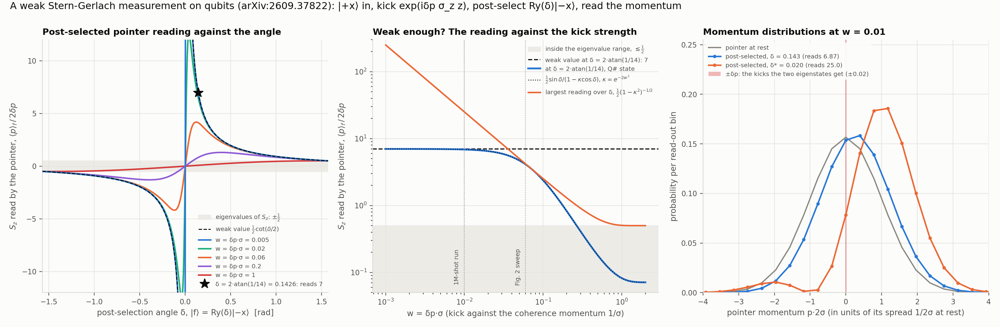
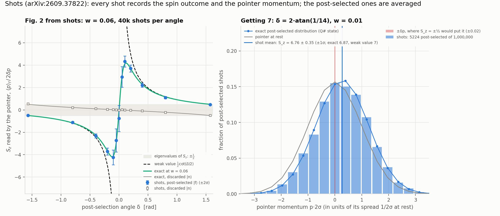

# Measuring the spin of a spin-½ and getting 7, in Q#

A Q# demo of *Measuring the spin of a spin-1/2 and getting a result of 7* (Joseph McGowan IV,
Nicholas Mantella, Noah Baker, Aephraim M. Steinberg, [arXiv:2609.37822](https://arxiv.org/abs/2609.37822)).
Equation and figure numbers follow the arXiv HTML version.

## The claim

Couple a system observable A weakly to a pointer, pre-select the system in |i⟩ and keep only the
runs where it is later found in |f⟩. Aharonov, Albert and Vaidman showed in 1988 that the
pointer then moves on average by the *weak value*

  ⟨A⟩_w = ⟨f|A|i⟩ / ⟨f|i⟩   (Eq. 2),

which for nearly orthogonal |i⟩ and |f⟩ lies far outside the eigenvalue range of A. Their
illustration was a weak Stern-Gerlach measurement of a spin-½, and that is the experiment the
paper performs, for the first time as proposed and with atoms: a Bose-Einstein condensate of
⁸⁷Rb, the two m = 0 hyperfine states as the spin, and a magnetic gradient that gives them equal
and opposite momentum kicks ±δp (Eq. 8). The spin starts in |i⟩ = |+x⟩ and is post-selected on
|f(δ)⟩ = Ry(δ)|−x⟩, so ⟨f|i⟩ = sin(δ/2), ⟨f|σ_z|i⟩ = cos(δ/2) and the weak value of σ_z is
cot(δ/2). A quarter period in the harmonic waveguide maps the atoms' momentum onto position,
where it is imaged. The largest shift they see is 14(6)·δp: the spin component S_z = σ_z/2,
whose eigenvalues are ±½, reads 7(3), the result in the title. A kick twice as strong makes the
measurement less weak and the amplification smaller (Fig. 3). (At the strength of the paper's
Fig. 2 the expected largest reading is about 4.2, so the 7 sits roughly one to one and a half
error bars above the paper's own model. The demo reads 7 at a weaker kick, see below.)

The weak value is the weak limit. For a finite kick the shift stays bounded: it passes through
zero at δ = 0 instead of diverging, and the largest shift it can reach is set by the width of
the pointer (Sec. II, after Duck, Stevenson and Sudarshan). The scale is the pointer's
*coherence momentum* 1/Δx, not its momentum spread, so the one number that says how weak the
measurement is is

  w = δp·σ,

the kick against 1/σ for a pointer of position standard deviation σ.

## What the demo does

**Circuits.** `src/WeakValue.qs` has the experiment on 7 qubits: the spin, and a 6-qubit
pointer holding a wave function on a 64-point position grid z_j = j − 63/2 (in grid steps).

- `PreparePointer`: a Gaussian with σ = 2 grid steps via `PreparePureStateD`. The grid is 32σ
  long, so neither the packet nor its momentum distribution comes near the edges (`verify.py`
  puts both tails below 10⁻¹⁵).
- `PrepareSpin`: H, the pre-selection |+x⟩.
- `WeakKick`: the coupling exp(iδp σ_z ẑ) of Eqs. 3 and 8. On a big-endian register
  ẑ = −Σ_q 2^(n−2−q) Z_q, so the Stern-Gerlach gradient is six commuting ZZ rotations,
  Rzz(δp·2^(n−1−q)) between the spin and pointer qubit q.
- `RotateToPostSelection`: Ry(−δ) then H, so a Z measurement of the spin gives One for |f(δ)⟩
  and Zero for the orthogonal |n(δ)⟩ = Ry(δ)|+x⟩. Both outcomes are kept, as the paper images
  both states.
- `MomentumToRegister`: the adjoint QFT, the circuit version of the quarter period in the
  waveguide (which for non-interacting atoms is a scaled Fourier transform). A plane wave of
  momentum 2πk₀/64 is read as k₀.

`RunExperiment` measures both registers and returns (spin outcome, momentum index).
`SimExperiment` stops just before the measurements and dumps the state, which holds the joint
amplitude of every (outcome, momentum) pair. Python reads the post-selection probability and
the mean momentum of the post-selected pointer off it, with no shots.

**The closed form.** For a real pointer wave function ψ the post-selected pointer is
ψ(z)·(a e^{iδp z} + b e^{−iδp z})/√2 with (a, b) = ⟨f|±z⟩. The cross term of its momentum
expectation vanishes after one integration by parts, which leaves

  ⟨p⟩_f / δp = A(δ) = sin δ / (1 − κ cos δ),   P(f) = (1 − κ cos δ) / 2,

where κ = ∫|ψ|² cos(2δp z) dz is the real part of the overlap of the two kicked pointer states
(the whole overlap for a symmetric pointer), e^{−2w²} for the Gaussian. Read off it:

- **Weak limit.** For κ → 1, A → sin δ/(1 − cos δ) = cot(δ/2), the weak value. The relative
  correction is −2w² cos δ/(1 − cos δ), so "weak" means w ≪ sin(δ/2) = |⟨f|i⟩|. The kick has to
  be small compared with the overlap the post-selection keeps, not just small.
- **The edges.** At δ = ±π/2 the post-selection picks |±z⟩ and A = ±1 for every strength: an
  ordinary Stern-Gerlach. At δ = 0, A = 0.
- **The largest shift.** A peaks at cos δ* = κ with A_max = 1/√(1 − κ²). For small w that is δ*
  ≈ 2w, A_max ≈ 1/(2w) (half the weak value there), and the largest shift A_max·δp falls to
  1/(2σ) from above as the kick weakens, instead of growing without bound. That limit is set by
  the position spread σ of the pointer (its coherence momentum), not by its momentum spread. For
  the minimum-uncertainty Gaussian the two coincide and 1/(2σ) is one standard deviation of its
  momentum.
- **The price.** The bare kick (spin in |+z⟩, read the momentum) already has Fisher information
  4σ² per shot about δp, the quantum limit for this coupling, so with shot noise alone no
  post-selection can estimate δp better. A·√P(f) ≤ 1, which is cos(δ/2) in the weak limit, says
  roughly the same for the shifted mean, but only roughly: the post-selected pointer can be up to
  13% narrower than the bare one (at δ ≈ 0.2 for w = 0.06), so the Fisher statement is the
  rigorous one. The metrological advantage the paper's introduction cites (its refs.
  13 to 16) needs other kinds of noise or limitations.
- **Any real pointer.** Nothing above used the Gaussian beyond κ. For the one-dimensional
  Thomas-Fermi model of the paper's Sec. II, |ψ|² ∝ 1 − z²/R², κ = 3(sin u − u cos u)/u³ with
  u = 2δpR (`verify.py` checks it). A three-dimensional Thomas-Fermi cloud has a different
  marginal and a different κ.

The "7" needs a weak value of σ_z of 14, so the demo post-selects at δ = 2·atan(1/14) = 0.1426
rad (8.2°), where |⟨f|i⟩|² = 0.51%. It also needs a weak enough kick: the largest mean reading
is 1/(4w), so 7 requires w ≤ 0.036. Fitting the closed form to the Gaussian curve of the paper's
Fig. 2 gives κ ≈ 0.993, w ≈ 0.06, where the largest post-selected reading is about 4.2 (4.3 for
the π_f − π_n the paper plots, in units of 2δp). That curve is κ = e^{−k²Δx²} with the stated
kick (4.4 µm/s, k = mδv/ħ) and Δx = R/√5 = 13.9 µm, the rms width of the 31 µm Thomas-Fermi
cloud, which matches the fit to five digits. A Gaussian of that rms width has κ = e^{−2k²Δx²}, w
≈ 0.083 and a largest reading of about 3.0, so the √2 between the two is the σ convention of the
paper's Eq. 5. Either way the paper's 7(3) (6.5 ± 2.9 at δ ≈ 0.038, read off its Fig. 2) is 0.8
error bars above the green curve's maximum (4.3) and 1.4 above the curve at its own angle (2.5).
The demo's Fig. 2 runs at w = 0.06, and its 7 at w = 0.01.

**The classical side.** `weak.py` is a numpy mirror of the grid model (Gaussian, kick,
projection, FFT) plus the closed forms. `experiment.py` has three stages, `plot.py` makes the
figures and `verify.py` runs the checks.

## Results



**(A)** What the post-selected pointer reads for S_z, ⟨p⟩_f / 2δp, against the post-selection
angle, from the Q# state for five strengths, with the weak value ½cot(δ/2) dashed. The w = 0.005
and w = 0.02 curves lie on the weak value over most of the range shown, and w = 0.005 reads 6.97
at the star. At w = 1 the curve barely leaves the eigenvalue band (largest reading 0.505).
**(B)** The reading at δ = 2·atan(1/14) against w: within 1% of 7 for w ≤ 0.0072 and within 10%
for w ≤ 0.024. The orange curve is the largest
reading over all δ, which grows as 1/(4w). **(C)** The momentum distributions behind it at
w = 0.01. The red band is ±δp, where the two eigenstates of S_z would put the pointer. The
post-selected distributions are displaced by 13.7·δp at the "7" angle, nearly a rigid shift,
and by 50·δp at the peak, where the mean has moved by one width but the shape has changed too:
the two kicked copies interfere into (1 + 2σp)² e^{−2σ²p²}, with a node at p = −1/(2σ).

| w = δp·σ | peak δ* | largest S_z reading | P(f) at the peak | S_z at δ = 2·atan(1/14) |
|---|---|---|---|---|
| 0.005 | 0.0100 | 50.0 | 5.0 × 10⁻⁵ | 6.97 |
| 0.02 | 0.0400 | 12.5 | 8.0 × 10⁻⁴ | 6.49 |
| 0.06 (fitted to the paper) | 0.120 | 4.18 | 7.1 × 10⁻³ | 4.12 |
| 0.2 | 0.395 | 1.30 | 0.074 | 0.82 |
| 1 | 1.435 | 0.505 | 0.49 | 0.08 |

Over all 1505 (w, δ) points of panel A, the reading from the Q# state matches the closed form
to a relative 3 × 10⁻¹², and P(f) to 2 × 10⁻¹⁵.



**(A)** The paper's Fig. 2 experiment from shots, at w = 0.06 (the strength fitted to its green
curve): 13 angles, 40 000 shots each. The post-selected reading (blue, ±2σ) follows the exact
curve through the amplified region, peaks near 4.2 and goes back through zero at δ = 0. The
discarded outcome (grey) stays inside the eigenvalue band. Near δ = 0 only about 150 of the
40 000 shots survive, which is why the error bars grow where the effect is largest, as in the
paper. The worst deviation from the exact value is 1.9σ over the 26 means and 1.7σ over the 13
rates. **(B)** One million shots at δ = 2·atan(1/14) and w = 0.01. 5224 are post-selected
(0.522%, exact 0.518%), and their mean momentum reads

  **S_z = 6.76 ± 0.35**  (exact at this strength 6.87, weak value 7),

against eigenvalues of ±½. The histogram matches the exact post-selected distribution
(χ² = 13.1 over 16 degrees of freedom). Its shift of 0.27 pointer widths is 13.5 times the δp
an eigenstate would give.

Full tables are in [`results/summary.txt`](results/summary.txt).

## Running it

```bash
python verify.py       # ~1.5 min
python experiment.py   # 5 to 6 min; `python experiment.py exact` (2 s) or `fig2` / `seven` alone
python plot.py         # figures + results/summary.txt
```

Requires the `qdk` package, numpy, scipy and matplotlib (all in the root `requirements.txt`).
Shots run in a pool of worker processes (one per core, up to 8).

## Verification

`verify.py` checks:

1. The prepared pointer is the numpy Gaussian, with position standard deviation σ, momentum
   standard deviation 1/(2σ), and tails below 10⁻¹⁵ inside the grid.
2. `WeakKick` leaves ψe^{+iδp z} on |+z⟩ and ψe^{−iδp z} on |−z⟩ (four kicks, one negative,
   one strong), with mean momenta ±δp.
3. Plane waves of momentum 2πk₀/64 are read as k₀ mod 64 (six values, among them −32, which
   is read as 32). With no kick both outcomes leave the pointer at rest, and P(f) = sin²(δ/2).
4. The spin algebra: ⟨f|i⟩ = sin(δ/2), ⟨f|σ_z|i⟩ = cos(δ/2), ⟨n|f⟩ = 0, δ = 2·atan(1/14)
   gives weak value 14, and δ = ±π/2 post-selects |±z⟩.
5. At 40 random (w, δ), the joint amplitudes Q# leaves equal the numpy mirror up to one global
   phase, and ⟨p⟩_f, ⟨p⟩_n and P(f) match the closed form.
6. The closed form against a continuum calculation by quadrature, with no grid and no Fourier
   transform, for the Gaussian and for the paper's 1D Thomas-Fermi pointer with κ its
   characteristic function. The Thomas-Fermi pointer also reads the weak value in the weak limit.
7. Limits: the leading weak-limit correction, A = ±1 at the edges and 0 at δ = 0 (from the Q#
   state), no amplification anywhere at w = 3, the peak position and height, the saturation of
   the largest shift at 1/(2σ), A·√P(f) ≤ 1, and the Fisher information 4σ² of the bare kick.
8. Shots: parallel chunks reproduce the serial stream bit for bit. At five settings the
   post-selection rate and both outcome means agree with the closed form within 3.5σ, and the
   post-selected momentum histograms pass a χ² test against the exact distribution. The
   standard errors match the exact spread of each outcome over √shots within 10%, so the error
   bars are neither too small nor too large.
9. The paper's Eq. 5 is the closed form here in its conventions, and Eq. 6 (with the sign of its
   exponent corrected) is the largest shift A_max·δp at every strength.

Three QDK behaviours this demo had to get right, all handled in the code:

- **Three endianness conventions.** `PreparePureStateD` and `DumpMachine` are big-endian
  (qubit 0 is the most significant bit), `MeasureInteger` is little-endian, and `ApplyQFT`
  takes a little-endian input and leaves a big-endian output. With the pointer stored
  big-endian, the adjoint QFT followed by `MeasureInteger` reads momentum k directly with the
  right sign. Python bit-reverses the dumped pointer index back into k (`driver.joint`).
  In `verify.py` the plane waves pin the read-out, and the comparisons of the dumped states
  with the numpy mirror (checks 2 and 5) pin the big-endian preparation and the bit reversal.
- **Shot cost.** About 1.4 ms per shot, mostly `PreparePureStateD`, so the 1.5 million shots of
  `experiment.py` run in a process pool. `qsharp.run(..., seed=s)` seeds shot i with s + i, so a
  run cut into chunks of 5000 seeded s, s + 5000, ... is exactly the serial run, which is what
  makes the parallel results reproducible.
- **Seed spacing.** Runs that must be independent are spaced by 10⁷ in seed, more than any shot
  count used.

## Files

| | |
|---|---|
| `src/WeakValue.qs` | pointer preparation, pre-selection, the weak kick as Rzz gates, the post-selection rotation, the momentum read-out, and `Experiment`, which chains them |
| `src/Main.qs` | `Sim*` entry points (dumps), `Run*` entry points (shots), the plane-wave read-out probe |
| `weak.py` | numpy mirror of the grid model and the closed forms |
| `driver.py` | Q#/numpy bridge, endianness handling, parallel shots, seed spacing |
| `experiment.py` | the three stages |
| `plot.py` | figures and `results/summary.txt` |
| `verify.py` | checks |

## Caveats

- The pointer is a Gaussian, as in the paper's analytic comparison (green curves of Figs. 2
  and 3), not the Thomas-Fermi profile of the actual condensate. The closed form covers the
  paper's 1D Thomas-Fermi model too (κ changes), and `verify.py` checks it in the continuum.
- There is no common-mode momentum noise, no imaging and no atom-number fluctuation. The paper
  measures π_f − π_n to cancel the first, and its large error bars near δ = 0 come from the
  low density of the post-selected cloud. Here the error bars come only from the post-selected
  shot count.
- The paper's Eq. 5 is exactly the closed form here once its δp is read as the relative kick
  2δp between the two components (Eqs. 3 and 8 give each of them ±δp) and its σ as √2σ
  (ψ ∝ e^{−z²/2σ²}). Eq. 6 then follows, with a minus sign in the exponent under the square
  root where the printed version has a plus, and its small-δp limit 1/(√2σ) in those units is
  1/(2σ) here. `verify.py` checks both.
- The paper's 7 is its largest shift, π_f − π_n = 14(6)·δp, divided by the 2δp that π_f − π_n
  reads at the edges. Since π_n ≈ 0 near δ = 0, that is ⟨p⟩_f/2δp, the S_z reading used here,
  and it corresponds to a σ_z weak value of 14 (the text calls it a weak value of 7 for σ_z, the
  title a result of 7 for the spin). The weak-value curve of the paper's Fig. 2 has the same
  factor of 2: it is 2δp·cot(δ/2), while the weak-limit π_f − π_n is 2δp/sin δ, about half of
  it near δ = 0. The text places the largest point at δ = 0.38, where ½cot(δ/2) is 2.6. In
  Fig. 2 it sits near δ ≈ 0.04, so 0.38 is probably 0.038.
- The paper's Fig. 2 plots π_f − π_n, which in units of 2δp is sin δ/(1 − κ² cos² δ): the same
  as the post-selected reading near δ = 0, but ±1 rather than ±½ at the edges. The demo's
  version plots the post-selected and the discarded readings separately.
- The read-out is the exact quantum Fourier transform. The waveguide's quarter period is the
  same transform, up to a scale factor and a global phase, only for non-interacting atoms. With
  mean-field interactions only the total centre of mass maps exactly, and the paper fits the centres
  of Thomas-Fermi profiles rather than taking means.
